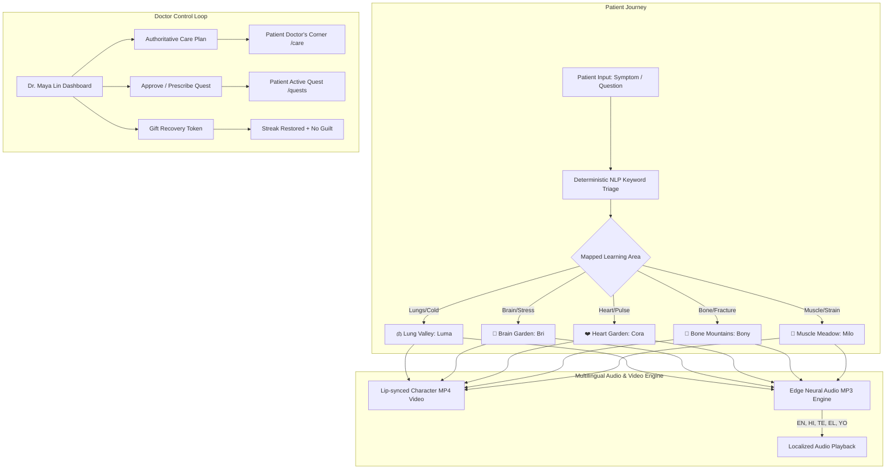

# 🌸 HitaBloom — Gamified Pediatric & Family Healthcare with Cultural Empathy

> **"Transforming clinical care into a whimsical garden of curiosity, gentle recovery, and cross-cultural understanding."**

Built and designed by **Shravan** 🚀

---

## 📖 Table of Contents
- [About Me & Why I Built HitaBloom](#-about-me--why-i-built-hitabloom)
- [What Makes HitaBloom Interesting & Unique](#-what-makes-hitabloom-interesting--unique)
- [Core Application Features](#-core-application-features)
  - [1. Dual Workspace Architecture (Patient & Doctor)](#1-dual-workspace-architecture-patient--doctor)
  - [2. The 5 Animated Body Guides](#2-the-5-animated-body-guides)
  - [3. Cultural Garden & Evidence-Grounded Global Traditions](#3-cultural-garden--evidence-grounded-global-traditions)
  - [4. Multilingual Neural Speech & Real-Time Translation](#4-multilingual-neural-speech--real-time-translation)
  - [5. Guilt-Free Gamification & Recovery Tokens](#5-guilt-free-gamification--recovery-tokens)
- [System Architecture & Data Flow](#-system-architecture--data-flow)
- [Tech Stack](#-tech-stack)
- [Project Directory Structure](#-project-directory-structure)
- [Getting Started & Local Setup](#-getting-started--local-setup)
- [Demo Credentials & Testing Walkthrough](#-demo-credentials--testing-walkthrough)
- [Medical Safety & Ethical Boundary](#-medical-safety--ethical-boundary)

---

## 💡 About Me & Why I Built HitaBloom

Hi! I'm **Shravan**, and I built **HitaBloom** to solve one of the deepest problems in modern digital health: **the clinical alienation and anxiety that patients feel when dealing with medical issues.**

When someone—especially a child, teenager, or non-English-speaking family—feels sick, they usually face two extremes:
1. **Intimidating, Cold Patient Portals:** Dense medical jargon, frightening PDFs, and portals that feel like an accounting spreadsheet.
2. **Online Doomscrolling:** Random searches on search engines that magnify mild symptoms into catastrophic diagnoses, inducing panic.

Moreover, modern clinical software rarely respects **cultural traditions**. When a grandmother suggests golden turmeric milk or herbal steam, traditional portals either ignore it or label it unscientific.

I asked myself:  
> *What if recovery felt like stepping into an enchanting, animated living garden? What if body systems were playful companions, traditional remedies were grounded in real pharmacology, and doctors remained the caring, authoritative guides at the center of the journey?*

**HitaBloom** is my answer. It marries **strict clinical governance** with **playful fantasy exploration**, **multilingual neural voice synthesis**, and **pediatric gamification**.

---

## ✨ What Makes HitaBloom Interesting & Unique

### 1. The Strict Non-Diagnostic Clinical Boundary
In HitaBloom, **AI never pretends to be a doctor**. AI has a strict educational mandate:
* It maps user words (*"my knee hurts"*, *"minor fracture"*, *"bad cough"*) to **educational body areas only** (e.g., Bone Mountains, Lung Valley).
* It **never diagnoses diseases**, prescribes medicines, or modifies dosages.
* **Dr. Maya Lin** is the human clinician in the loop. The AI translates and explains Dr. Maya's verbatim words in simple language, but Dr. Maya's original instructions remain the gold standard.

### 2. Multi-Organ Character Chat Isolation
Unlike typical chatbots that bleed conversation state across contexts, HitaBloom maintains **isolated per-character and per-patient conversation threads**:
* Inquiries asked to **Luma (Lungs)** stay in Lung Valley.
* Opening **Bri (Brain)** presents a clean, dedicated neural thread.
* Inquiries in **Cora (Heart)**, **Bony (Bones)**, and **Milo (Muscles)** remain self-contained.

### 3. Real 5-Language Multilingual Neural Voice Engine
HitaBloom supports **English, Telugu (`తెలుగు`), Hindi (`हिंदी`), Greek (`Ελληνικά`), and Yoruba (`Èdè Yorùbá`)**:
* Pre-rendered **35+ high-fidelity Microsoft Edge Neural Voice MP3 tracks** (`Shruti`, `Swara`, `Nestoras`, `Ezinne`, `Jenny`).
* Dynamic fallback to the browser's native **SpeechSynthesis API** with auto-detected BCP-47 language tags.
* Auto-detection and keyword routing for non-Latin scripts (e.g. `జలుబు` for cold, `నీరు` for water in Telugu, `हड्डी` for bones in Hindi).

### 4. Guilt-Free Gamification (The Recovery Token System)
Most gamified apps punish users with broken streaks when they miss a day. In healthcare, missing a day often happens because a patient is exhausted or resting!  
HitaBloom introduces **Doctor-Issued Recovery Tokens**:
* When a patient misses a quest, Dr. Maya can send a supportive note and a **Recovery Token**.
* The token restores the patient's streak with the message: *"Rest is part of recovery too."*

---

## 🌟 Core Application Features

### 1. Dual Workspace Architecture (Patient & Doctor)
HitaBloom features two fully functional role-based workspaces:

| Workspace | Key Capabilities |
| :--- | :--- |
| **Patient World** | Interactive World Map, Symptom Triage, Animated Organ Guides, Cultural Wellness Garden, Doctor's Corner, Daily Health Quests, Streaks & XP, Avatar Studio. |
| **Doctor Portal (`Dr. Maya Lin`)** | Clinical Patient Directory, Live Symptom & Garden Progress Oversight, Care Plan Authoring & Real-Time Sync, Quest Prescription & Approval Queue, Supportive Messaging, Recovery Token Dispenser. |

---

### 2. The 5 Animated Body Guides

Each body system is personified by a whimsical animated guide with lip-synced video, natural expressions, and multi-language dialogues:

| Character | Location | Domain | Personality & Educational Focus |
| :--- | :--- | :--- | :--- |
| **🫁 Luma** | Lung Valley | Respiratory & Airway | Warm, witty explorer. Explains lung mucosal barriers, steam, airway clearance, and warm hydration during colds. |
| **🧠 Bri** | Brain Garden | Neurological & Mind | Vibrant thinker with sparkling neurons. Teaches cognitive pacing, sleep hygiene, screentime breaks, and stress calming. |
| **❤️ Cora** | Heart Garden | Cardiovascular | Energetic guardian. Pumps 24/7 without vacation days! Teaches rhythmic breathing, heart rate, and gentle aerobic strolls. |
| **🦴 Bony** | Bone Mountains | Skeletal & Orthopedic | Strong, upright companion. Covers posture, mineral density, calcium, joint mobility, sprains, and fracture recovery. |
| **💪 Milo** | Muscle Meadow | Musculoskeletal | Athletic and encouraging. Explains muscle recovery, gentle post-exercise stretches, hydration, and strain relief. |

---

### 3. Cultural Garden & Evidence-Grounded Global Traditions

HitaBloom honors cultural diversity by featuring **5 authentic Cultural Guides** representing distinct regions:
* **India (Haldi Doodh & Sesame Abhyanga):** Explains curcumin's biochemical modulation of inflammatory cascades (`COX-2`, `NF-κB`) alongside warm joint massage.
* **Greece (Mediterranean Diet, Sea Air & Tahini):** Explains calcium-rich sesame paste, sun-dried omega-rich fish, and coastal breathing.
* **Nigeria (Bitter Leaf, Hibiscus & Shea Butter):** Explains traditional West African restorative infusions backed by modern antioxidant and vascular evidence.

---

### 4. Multilingual Neural Speech & Real-Time Translation

HitaBloom eliminates language barriers in healthcare:
* When a Telugu-speaking user enters *"జలుబు, నీరు గురించి డాక్టర్ మాయా మరియు ఆరోగ్య సలహా?"*, HitaBloom recognizes the native Telugu medical tokens (`జలుబు` = cold, `నీరు` = water) and responds with tailored advice from Luma voiced by **Shruti Neural**.
* Questions typed in English for non-English user profiles are automatically translated in real-time within the chat box.

---

## 🏗️ System Architecture & Data Flow



---

## 🛠️ Tech Stack

### Frontend & Core Engine
* **Framework:** React 19 (TypeScript)
* **Build Tool:** Vite 7 with Rollup
* **Routing:** Wouter (Ultra-lightweight declarative routing)
* **Styling & Design System:**
  * Tailwind CSS v4
  * Custom Glassmorphism UI Engine (`hitabloom.css`, `redesign.css`)
  * Radix UI Component Primitives
  * Lucide React Icons
* **Data Fetching:** TanStack React Query

### Audio, Video & Speech Synthesis
* **Microsoft Edge TTS (`edge-tts`):**
  * `en-US-JennyNeural` (English)
  * `te-IN-ShrutiNeural` (Telugu)
  * `hi-IN-SwaraNeural` (Hindi)
  * `el-GR-NestorasNeural` (Greek)
  * `yo-NG-EzinneNeural` (Yoruba)
* **Speech Engine:** Dual-layer architecture:
  1. Primary: 35+ pre-rendered high-bitrate neural MP3 audio tracks in `/public/assets/audio/`
  2. Fallback: Browser Web Speech API (`SpeechSynthesis`) with auto-language voice matching
* **Video Playback:** Responsive HTML5 Video elements with mute controls, poster fallbacks, and sound-wave visualizers.

### State & Storage
* **Architecture:** React Context + `localStorage` persistence layer (`store.tsx`).
* **Multi-Account Simulation:** Seamless instant role switching between Doctor (`Dr. Maya Lin`) and 5 localized patient profiles (`Aarav`, `Sofia`, `Priya`, `Chen`, `Amara`).

---

## 📁 Project Directory Structure

```
HitaBloom/
├── artifacts/
│   └── hitabloom/
│       ├── public/
│       │   └── assets/
│       │       ├── audio/
│       │       │   ├── characters/      # Character introduction voiceovers
│       │       │   └── replies/         # 35 neural reply audio tracks (5 languages x 7 topics)
│       │       ├── characters/          # High-res character videos (.mp4) and posters (.png)
│       │       ├── landing/             # Whimsical hero artwork
│       │       └── world/               # Interactive living garden map
│       ├── src/
│       │   ├── components/              # Radix UI and custom accessible components
│       │   ├── data.tsx                 # Core registry, character lines, symptom routing
│       │   ├── doctor-pages.tsx         # Dr. Maya clinical dashboard, quest reviewer, care plan editor
│       │   ├── hb-ui.tsx                # Glassmorphic layout panels, avatars, metrics, progress bars
│       │   ├── patient-pages.tsx        # World map, organ guides, cultural garden, care page, quests
│       │   ├── screens.tsx              # Clean export facade for all application views
│       │   ├── services.ts              # Translation, speech synthesis, cultural data, NLP triage
│       │   ├── store.tsx                # Central reactive store, session management, multi-account state
│       │   ├── App.tsx                  # Protected role-gated routes & Wouter router setup
│       │   └── main.tsx                 # React DOM root entry
│       ├── package.json
│       ├── tsconfig.json
│       └── vite.config.ts
├── package.json                         # Workspace monorepo root
└── README.md                            # Comprehensive project guide
```

---

## 🚀 Getting Started & Local Setup

### Prerequisites
* **Node.js** v18+ or v20+
* **pnpm** (recommended: `corepack enable pnpm` or `npm install -g pnpm`)

### Installation & Launch

1. **Clone or navigate to the repository:**
   ```bash
   cd c:\Users\shrav\OneDrive\Desktop\HitaBloom
   ```

2. **Install all dependencies:**
   ```bash
   pnpm install
   ```

3. **Start the local development server:**
   ```bash
   pnpm --filter @workspace/hitabloom run dev
   ```
   Open your browser to the URL displayed in the console (typically `http://localhost:5173`).

4. **Verify TypeScript & Production Build:**
   ```bash
   # Run type checks
   pnpm --filter @workspace/hitabloom run typecheck

   # Run production build
   pnpm --filter @workspace/hitabloom run build
   ```

---

## 🔐 Demo Credentials & Testing Walkthrough

You can test HitaBloom with zero setup using the built-in single-click demo profiles:

### 1. Doctor Experience (Dr. Maya Lin)
* **Email:** `drmaya@hitabloom.demo` (Password: any password)
* **Key Flows to Test:**
  * Open **Patients Directory** (`/doctor/patients`) and select **Aarav**.
  * Edit the **Care Plan & Follow-Up** and click **Save Care Plan**.
  * Prescribe a new quest using the 1-click templates (*Heart Harmony Walk*, *Gentle Mobility & Posture*) and click **Assign Quest**.
  * Send a **Recovery Token** to restore patient streak.

### 2. Patient Experience
Click any patient profile on `/login` to log in instantly:
* **Aarav (Telugu / తెలుగు):** `aarav@hitabloom.demo`
* **Sofia (Greek / Ελληνικά):** `sofia@hitabloom.demo`
* **Priya (English):** `priya@hitabloom.demo`
* **Chen (English / Mandarin):** `chen@hitabloom.demo`
* **Amara (Yoruba / Èdè Yorùbá):** `amara@hitabloom.demo`

**Recommended Patient Test Journey:**
1. **Symptom Triage (`/journey`):** Type *"I have a minor fracture"* → Watch the AI route accurately to **Bone Mountains** (Bony).
2. **Body Exploration (`/character`):** Use the top **Organ Switcher Bar** to toggle between **Luma**, **Bri**, **Cora**, **Bony**, and **Milo**. Each guide maintains its own isolated conversation and plays real neural audio.
3. **Cultural Garden (`/cultural`):** Switch between English, Telugu, Hindi, Greek, and Yoruba to meet regional cultural elder figures and explore evidence-grounded self-care traditions.
4. **Doctor's Corner (`/care`):** View Dr. Maya's verbatim clinical instructions broken into clean action steps, follow-up notes, and listen to Dr. Maya's voice.
5. **Wellbeing Quests (`/quests`):** Complete your doctor-assigned daily milestone and watch your living garden bloom (+50 XP)!

---

## ⚖️ Medical Safety & Ethical Boundary

> [!IMPORTANT]
> **HitaBloom is strictly an educational wellbeing companion and patient-clinician engagement platform.**
> - It **does NOT** diagnose medical conditions.
> - It **does NOT** prescribe medications or adjust clinical dosages.
> - In an emergency, patients are always directed to contact local emergency services or their licensed clinician immediately.
> - Licensed clinicians (such as Dr. Maya Lin) maintain absolute authority over all care plans and medical advice.

---

*Designed and crafted with care by **Shravan**.* 🌸✨
